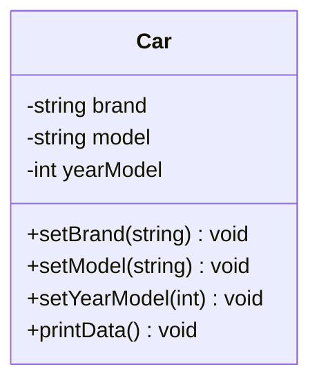
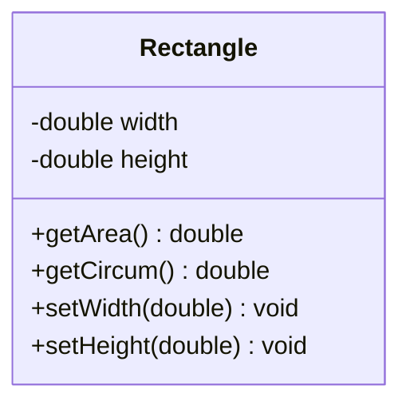
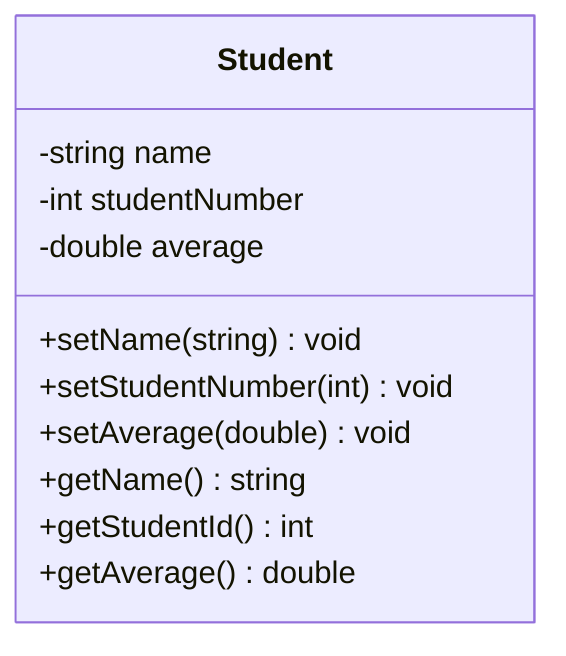

# H2a - Luokka, olio
\
Tee jokaiselle luokalle oma .h- ja .cpp-tiedosto. Noudata kussakin luokassa periaatetta:

- jäsenmuuttujat ovat privaatteja
- metodit ovat publikkeja
- Luo C++-projekti nimeltään h2a

## Car-luokka
Lisää projektiin luokka nimeltä Car. Tällä luokalla tulisi olla seuraavat jäsenmuuttujat ja metodit:

\
**Jäsenmuuttujat**:
- brand: merkkijono, joka sisältää auton merkin.
- model: merkkijono, joka sisältää auton mallin.
- yearModel: kokonaisluku, joka sisältää auton valmistusvuoden.

\
**Metodit**:

- printData(): tulostaa auton merkin, mallin ja valmistusvuoden.
- setBrand(string): asettaa auton merkin.
- setModel(string): asettaa auton mallin.
- setYearModel(int): asettaa auton valmistusvuoden.

\
**UML-kaavio**

\
**Pääohjelmassa:**

Luo Car-olio pinomuistiin ja aseta sille merkki, malli ja vuosi.

Tulosta auton tiedot käyttämällä printData()-metodia.

## Rectangle-luokka

Lisää projektiin luokka nimeltä nimeltä Rectangle. Tällä luokalla tulisi olla seuraavat jäsenmuuttujat ja metodit:

\
**Jäsenmuuttujat**:
- width: reaaliluku(double), joka määrittää suorakulmion leveyden.
- height: reaaliluku(double), joka määrittää suorakulmion korkeuden.

\
**Metodit**:
- getArea(): laskee ja palauttaa suorakulmion pinta-alan kaavalla width * height.
- getCircum(): laskee ja palauttaa suorakulmion ympärysmitan kaavalla 2 * (width + height).
- setWidth(double): asettaa suorakulmion leveyden.
- setHeight(double): asettaa suorakulmion korkeuden.

\
**UML-kaavio**

\
**Pääohjelmassa:**

Luo Rectangle-olio kekomuistiin ja aseta sen leveys ja korkeus. Tulosta suorakulmion pinta-ala ja ympärysmitta. Tuhoa olio.

## Student-luokka

Lisää projektiin luokka nimeltä Student. Tällä luokalla tulisi olla seuraavat jäsenmuuttujat ja metodit:

Käytä tässä harjoituksessa hyväksesi Qt-Creatorin Refactor -toimintoa. Kun olet luonut jäsenmuuttujat, klikkaa hiiren oikealla ja valitse "Add Getter and Setter ...".

\
**Jäsenmuuttujat:**

- name: merkkijono, joka sisältää opiskelijan nimen.
- studentNumber: kokonaisluku, joka sisältää opiskelijanumeron.
- average: reaaliluku, joka sisältää opiskelijan keskiarvon.

\
**Metodit:**

- **Setterit:** 
    - setName(string): asettaa opiskelijan nimen.
    - setStudentNumber(int): asettaa opiskelijanumeron.
    - setAverage(double): asettaa opiskelijan keskiarvon.

- **Getterit:**
    - string getName(): palauttaa opiskelijan nimen.
    - int getStudentNumber(): palauttaa opiskelijanumeron(merkkimuotoinen tunniste).
    - double getAverage(): palauttaa opiskelijan keskiarvon.

\
**Pääohjelmassa:**

Luo Student-olio smart pointerilla ja aseta sille nimi, opiskelijanumero ja keskiarvo.
Tulosta opiskelijan tiedot käyttämällä get-metodeja.