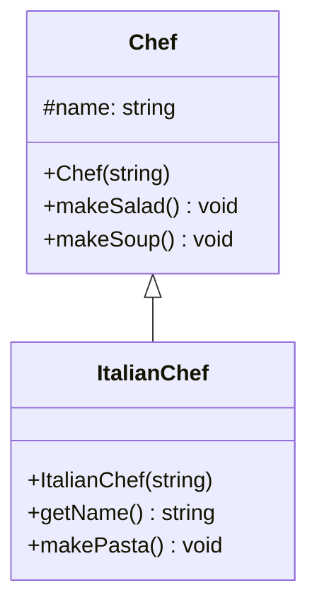

# Tehtävä h3a - Perintä

Luo C++-projekti nimeltään h3a.

__Kantaluokka Chef:__
1. Luotuasi projektin, lisää siihen alla esitetyn UML-kaavion mukainen luokka Chef.
2. Toteuta Chef-luokka niin, että jäsenfunktiot mukaan lukien konstruktori ja destruktori tulostavat  debug tietoa ruudulle. Konstruktorille annetaan parametrina kokin nimi.
3. Luo mainissa Chef-luokasta automaattinen olio (pinomuistiin), anna kokin nimeksi Gordon Ramsay
4. Kutsu metodeja makeSalad ja makeSoup
5. Suorita sovellus.

__Aliluokka ItalianChef:__

1. Lisää luokka ItalianChef, joka perii luokan Chef
2. Toteuta ItalianChef-luokka niin, että jäsenfunktiot mukaan lukien konstruktori ja destruktori tulostavat debug tietoa ruudulle. Konstruktorille annetaan parametrina kokin nimi. Metodi getName() palauttaa kokin nimen.
3. Huomaa, että koska Chef-luokan muodostin ottaa parametrin, sinun on kutsuttava ItalianChef luokan konstruktorissa tuota muodostinta kts. kantaluokan muodostin
4. Luo mainissa ItalianChef-luokasta automaattinen olio (pinomuistiin), anna kokin nimeksi Anthony Bourdain
5. Kutsu metodeja makeSalad, makeSoup, makePasta ja getName (tulosta sen palauttama nimi cout:lla)
6. Suorita sovellus.

